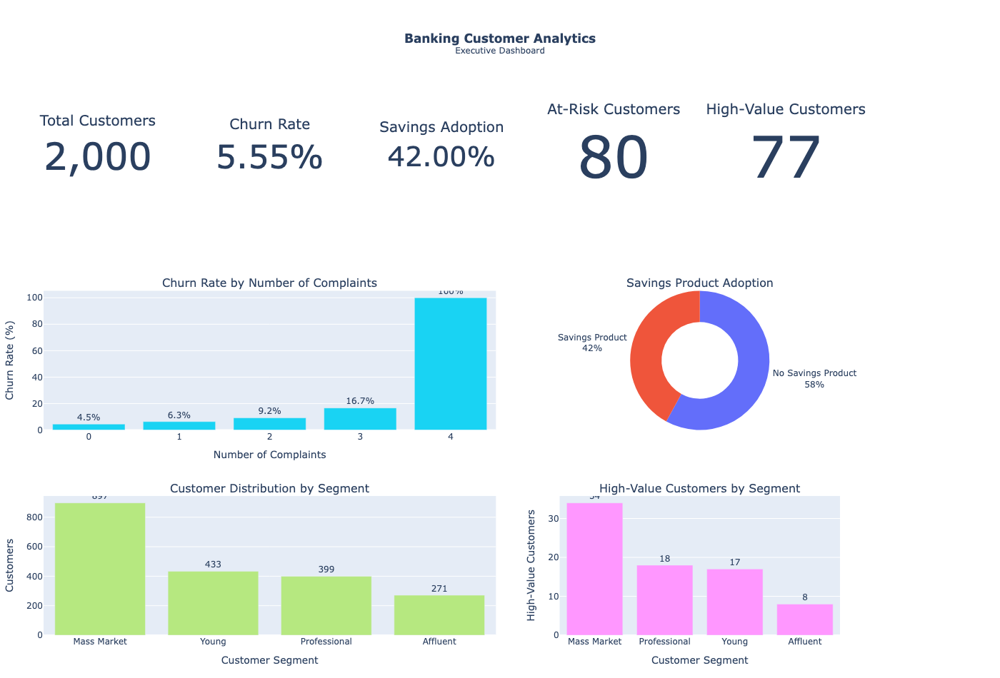

# 🏦 Banking Customer Analytics

## Project Overview

This project analyzes a banking customer dataset to identify actionable insights related to customer retention, savings opportunities, segmentation, and customer value.

The objective is to demonstrate an end-to-end Data Analyst workflow, from data cleaning and exploratory analysis to SQL querying, visualization, and business recommendations.

## Business Questions

The analysis focuses on five key questions:

1. What factors are associated with customer complaints and churn?
2. Which banking opportunities exist among younger customers?
3. Which customers have the strongest potential for savings products?
4. Which customers present a higher risk of leaving the bank?
5. What characteristics define high-value customers that could inform future acquisition strategies?

## Tools & Technologies

- Python
- Pandas
- SQL / SQLite
- Plotly
- Google Colab
- GitHub

## Dataset

The cleaned dataset contains **2,000 banking customers** and includes information about:

- Age and city
- Monthly income
- Account balance
- Number of banking products
- Monthly transactions
- Customer complaints
- Savings product ownership
- Customer segment
- Customer churn

Data cleaning included duplicate removal, missing-value treatment, age anomaly correction, and data validation.

## Key Findings

- Overall customer churn rate: **5.55%**
- Savings product adoption: **42%**
- **58%** of customers do not currently hold a savings product.
- **80 customers** were identified as higher-risk based on repeated complaints and low product ownership.
- Customers with repeated complaints show higher churn rates.
- **140 high-potential non-savers** were identified for targeted savings opportunities.
- **43 high-potential young non-savers** were identified among customers aged 18–30.
- **77 customers (3.85%)** meet the defined high-value customer criteria.

## Executive Dashboard



## Business Recommendations

- Prioritize customers with repeated complaints for proactive retention actions.
- Target financially strong non-savers with personalized savings offers.
- Develop dedicated savings campaigns for high-potential customers aged 18–30.
- Monitor customers with low product ownership and identify relevant cross-selling opportunities.
- Protect high-value customers through personalized relationship management and proactive service.
- Use the characteristics of existing high-value customers as a reference for future acquisition strategies.

## Project Structure

```text
Banking-Customer-Analytics/
├── README.md
├── banking_customer_analytics.ipynb
├── bank_customers_clean.csv
└── dashboard.png
